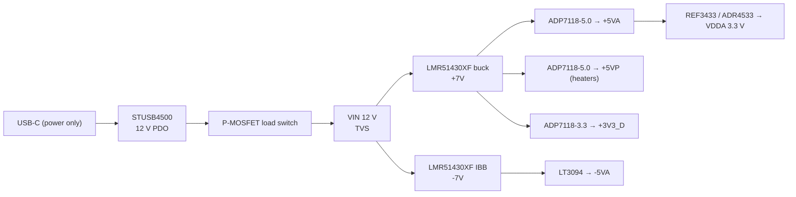
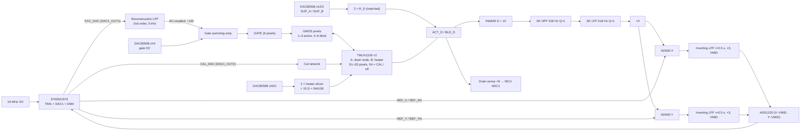

# GMOS LIA Board — Schematic Overview & Hardware Design

How the board implements [requirements.md](requirements.md). Theory is in [measurement_principles.md](measurement_principles.md); the list of what is still wrong or missing in the current KiCad netlist is in [schematic_review.md](schematic_review.md). Values marked `TBD` are not yet in the schematic.

## 1. Schematic Overview

### 1.1 Sheet Map

Hierarchy as exported on 2026-10-20 (`GMOS-LIA.net`, KiCad 10). Status: ✅ complete, 🟡 partial, ❌ not started / to be replaced.

| # | Sheet path | File | Content | Status |
|---|------------|------|---------|--------|
| 1 | `/` | GMOS-LIA.kicad_sch | Root, hierarchical blocks only | 🟡 |
| 2 | `/DC/` | DC.kicad_sch | Power section container | 🟡 |
| 10 | `/DC/USB_PD/` | usb_pd.kicad_sch | USB-C connector, STUSB4500, input load switch | 🟡 wiring incomplete |
| 11 | `/DC/Regulators/` | regulators.kicad_sch | +7 V buck, −7 V IBB, LDOs | 🟡 values wrong |
| 3 | `/Analog/` | Analog.kicad_sch | Analog container | 🟡 |
| 4 | `/Analog/oscillator/` | oscillator.kicad_sch | **To be renamed `excitation`**: reconstruction LPF + gate summing amp | ❌ replace (D-3) |
| 6 | `/Analog/LIA_FE/` | lia_fe.kicad_sch | INA828, band-pass, ×4, AD630 X/Y, post-filters | 🟡 |
| 5 | `/GMOS_MUX/` | GMOS_MUX.kicad_sch | GMOS socket J1, 2× TMUX1109 pixel selection, 2× R_D, cal input | 🟡 rework (D-12) |
| 8 | `/DAC/` | dac.kicad_sch | DAC80508, 2 heater drivers, 2 INA190, drain sense | 🟡 rework (D-13) |
| 7 | `/ADC/` | adc.kicad_sch | ADS1220 | 🟡 |
| 9 | `/MCU/` | mcu.kicad_sch | STM32U575, XO, VDDA reference, SWD, UART isolation, sensors | ❌ mostly unconnected |
| 12 | `/Connectors/` | connectors.kicad_sch | USB-C power connector, CC ESD | 🟡 |

### 1.2 Net Naming

| Net | Meaning |
|-----|---------|
| `VCC` → rename `+7V` | Buck output |
| `VEE` → rename `-7V` | IBB output |
| `+5VA`, `-5VA` | Analog rails |
| `+5VP` | Heater rail (D-10) |
| `+3V3_D` | Digital rail (the stray `+3V3` label must be merged into it) |
| `VDDA` | 3.3 V precision reference rail: MCU VDDA/VREF+, INA190 supply |
| `GATE` | Common gate of all pixels (currently `/GMOS_MUX/gate_voltage`, must connect to `v_gate`) |
| `DRAIN_n`, `HEATER_n` | Pixel n = 1…6 at the socket (1–3 active, 4–6 blind) |
| `ACT_D`, `BLD_D` | Drain node of the selected active / blind pixel (mux common): R_D, INA828 ±IN, drain sense |
| `SUP_A`, `SUP_B` | Drain supply (DAC side of R_D), active / blind |
| `ACT_HTR`, `BLD_HTR` | Heater force line of the selected pixel (shunt output, Kelvin feedback point, mux common) |
| `IHTR_A`, `IHTR_B` | INA190 outputs |
| `MUXA_A0/A1/EN`, `MUXB_A0/A1/EN` | Pixel-select GPIO, active / blind side |
| `REF_X/REF_XN`, `REF_Y/REF_YN` | MCU references → AD630 SEL B / SEL A |
| `EXC_DAC`, `CAL_DAC` | MCU DAC1_OUT1 / DAC1_OUT2 |
| `VMID` | X/Y mid-scale reference (DAC80508) |

Use global labels only for rails; use hierarchical labels with **identical names on both sides** for signals. Most dangling nets in the current netlist come from mismatched hierarchical names ([schematic_review.md](schematic_review.md) §A).

### 1.3 GMOS Socket (J1, DIP-40) Pin Map

Pin numbers from the netlist labels `drain_n` / `heater_n`.

| Pixel | Role | Mux position | Drain pin | Heater+ pin | Gate pin | Source / Heater− |
|-------|------|--------------|-----------|-------------|----------|------------------|
| 1 | Active | U_MA S1 | 17 | 11 | 12 | 13 / 16 → GND |
| 2 | Active | U_MA S2 | 10 | 4 | 5 | 6 / 9 → GND |
| 3 | Active | U_MA S3 | 3 | 39 | 40 | 1 / 2 → GND |
| 4 | Blind | U_MB S1 | 38 | 31 | 32 | 33 / 37 → GND |
| 5 | Blind | U_MB S2 | 30 | 23 | 24 | 25 / 29 → GND |
| 6 | Blind | U_MB S3 | 22 | 18 | 19 | 20 / 21 → GND |

Pins 8, 28 = GND; 15, 36 = VDD (+5VA, ESD protection, AN-33); 7, 14, 26, 27, 34, 35 = NC.

---

## 3. DC (Power) Section

### 3.1 Purpose

All rails are generated on-board from a single USB-C PD input, so the board is portable and needs one cable for power (the PC link uses a separate, isolated USB connector).

### 3.2 Architecture

The STUSB4500 negotiates a 12 V PDO and only then enables the input load switch, so the converters never start from 5 V. `VIN` feeds two parallel chains:

- **Positive chain:** buck → +7 V → three LDOs (+5VA analog, +5VP heaters, +3V3_D digital). A precision 3.3 V reference supplied from +5VA provides VDDA.
- **Negative chain:** the same buck IC in inverting buck-boost (IBB) topology [[A1]](README.md#ref-a1) → −7 V → LT3094 → −5VA.



### 3.3 Component Selection

Prices and stock were last checked 2026-10-01 and must be re-checked (distributor APIs unavailable 2026-10-20).

| Function | Part | Key specs | Why |
|----------|------|-----------|-----|
| PD sink | STUSB4500QTR | Standalone PD sink, NVM-configured PDOs, I²C for status | No firmware dependency to get power; MCU can reconfigure (DG-9) |
| Input switch | **AO3407A** (P-ch, −30 V, ±20 V V_GS, 52 mΩ @ −4.5 V, SOT-23); LCSC C15155 (AOS, ≈ USD 0.11) or second-source clones ≈ USD 0.04 | Driven by VBUS_EN_SNK (open drain, 28 V abs max) | Replaces the generic SPICE `NMOS` symbol Q1. Load ≈ 0.15 A → 1 mW dissipation |
| Input TVS | **SMAJ18A** (unidirectional, V_RWM 18 V, V_BR ≥ 20 V, V_C 29.2 V @ 13.7 A, 400 W, SMA); LCSC C908771 ≈ USD 0.03, Littelfuse C148219 ≈ USD 0.11 | On VBUS, connector side | 18 V stand-off clears a 15 V PDO + 5 %; clamp stays below the 28 V STUSB4500 and 36 V LMR51430 ratings |
| Rail clamps | **B5819W** (Schottky, 40 V, 1 A, SOD-123); LCSC C7420330 / C64885 (JLC preferred) ≈ USD 0.02 | D4: +5VA→GND (cathode on +5VA), D5: GND→−5VA (anode on −5VA) | DC-4a. Leakage is µA-level at 5 V reverse, irrelevant on a rail |
| +7 V buck | LMR51430XFDDCR | 4.5–36 V, 3 A, 500 kHz **FPWM**, V_FB = 0.6 V | FPWM keeps switching artefacts out of the signal band (DC-7) |
| −7 V IBB | LMR51430XFDDCR | Same part, IC ground on −7 V | BOM reuse |
| +5VA, +5VP | **ADP7118ACPZN5.0-R7** (fixed 5.0 V, LFCSP-6 2×2, same footprint as now); LCSC C659349 ≈ USD 2.2 | 20 V in, 200 mA, 11 µVrms | Fixed version: no feedback resistors (§3.4.3) |
| +3V3_D | **ADP7118ACPZN3.3-R7** (fixed 3.3 V); LCSC C659348 ≈ USD 2.3 (lower stock) | | Cheaper option, digital rail only: AMS1117-3.3 (SOT-223, ≈ USD 0.1, JLC basic; 15 V max in, 0.3 W dissipation is fine). Not for the analog rails |
| −5VA | LT3094EMSE | −500 mA, 0.8 µVrms, high PSRR | |
| VDDA | REF3433 or ADR4533 (3.3 V, ≥ 10 mA, ≤ 10 ppm/°C; verify output current) | Supplied from +5VA | LQFP64 STM32U575 has no VREFBUF: VDDA is the DAC/ADC reference (DC-4c, AN-7) |

### 3.4 Design Calculations

#### 3.4.1 Positive Buck (+7 V)

| Item | Calculation | Value |
|------|-------------|-------|
| Feedback divider | V_OUT = 0.6 V · (1 + R_top/R_bot), R_bot = 10.0 kΩ | R_top = 107 kΩ → 7.02 V (**schematic has 5.1 kΩ / 820 Ω → 4.33 V**) |
| Duty cycle | D = V_OUT/V_IN | 0.47–0.64 |
| Inductor | L = V_OUT(V_IN − V_OUT)/(V_IN·f_SW·ΔI_L) | **8.2 µH** (schematic 6.2 µH: acceptable, ripple ≈ +30 %), I_sat ≥ 1.5 A (≥ 6.7 A for short-circuit robustness) |
| Output ripple | ΔV = ΔI_L/(8·f_SW·C_OUT), C_OUT,eff ≈ 20 µF | 8–11 mV |
| Capacitors | | C_IN 2 × 4.7 µF 50 V + 100 nF; C_OUT 2 × 22 µF 25 V; C_BOOT 100 nF; C_FF 10 pF optional |

EN is tied to VIN (allowed, EN ≤ V_IN + 0.3 V [[D1]](README.md#ref-d1)).

#### 3.4.2 Inverting Buck-Boost (−7 V)

The IC **GND pin connects to −7 V**, the inductor from SW to system GND. The IC sees V_IN + |V_OUT| = 18–22 V (< 36 V).

| Item | Calculation | Value |
|------|-------------|-------|
| Feedback divider | R_top from system GND to FB, R_bot from FB to −7 V | 107 kΩ / 10.0 kΩ (**schematic 1 kΩ / 1 kΩ**) |
| Duty cycle | D = \|V_OUT\|/(V_IN + \|V_OUT\|) | 0.32–0.39 |
| Inductor | 8.2 µH, ΔI_L = V_IN·D/(L·f_SW) | 1.04–1.16 A, peak ≈ 0.8 A |
| Max output current | (I_LIM,min − ΔI_L/2)·(1 − D) | ≈ 1.9 A ≫ load |
| Right-half-plane zero | f_RHPZ = (1 − D)²·R_LOAD/(2π·D·L) | ≈ 1 MHz ≫ crossover |
| Capacitors | C_IN between VIN and **−7 V** (≥ 50 V) plus VIN to GND; C_OUT between GND and −7 V | 2 × 4.7 µF 50 V; 2 × 22 µF 25 V |

#### 3.4.3 Linear Regulators and Reference

| Regulator | Settings | Dissipation (worst case) |
|-----------|----------|--------------------------|
| ADP7118ACPZN5.0 → +5VA (U5) | Fixed. **Delete R12, R13**; SENSE/ADJ (pin 2) → VOUT (pin 1), routed to the load side of C_OUT | 2.0 V × 45 mA ≈ 0.09 W |
| ADP7118ACPZN5.0 → +5VP (U4) | Fixed. **Delete R10, R11**; SENSE/ADJ → VOUT | 2.0 V × 21 mA ≈ 0.04 W |
| ADP7118ACPZN3.3 → +3V3_D (U20) | Fixed. **Delete R51, R52**; SENSE/ADJ → VOUT | 3.7 V × 85 mA ≈ 0.31 W |
| All three ADP7118 | EN (4) → VIN (as drawn); SS (5) open = 380 µs start-up (do **not** ground SS); C_OUT ≥ 2.2 µF X7R (use 4.7–10 µF); C_IN 1 µF + 100 nF; EP → GND | |
| LT3094 → −5VA | R_SET = 50 kΩ (49.9 kΩ 0.1 % preferred) → −5.0 V; C_SET 4.7 µF; C_OUT 10 µF; C_IN 10 µF; ILIM/VIOC/PGFB per datasheet | 2 V × 25 mA ≈ 0.05 W |
| VDDA reference | Per datasheet (C_OUT, C_IN); load ≈ 3–5 mA (ADC1, DAC1 buffers, INA190 ×2) | < 10 mW |

Each switcher → LDO path has a 0 Ω series resistor with two DNP capacitor footprints (π-filter placeholder) so a ferrite bead can be fitted later if 500 kHz ripple appears downstream.

#### 3.4.4 USB-C PD Input

STUSB4500 per the ST reference design: VDD on VBUS (connector side), VSYS to +3V3_D or GND, CC1/CC2 to the connector CC pins and CC1DB/CC2DB tied to CC1/CC2 (dead-battery support), VREG_1V2 and VREG_2V7 decoupled (1 µF each), RESET and ADDR0/1 to GND, I²C to the MCU (with pull-ups), VBUS_EN_SNK driving the P-MOSFET gate. Power path (per the ST example schematic, 100 kΩ / 22 kΩ): Q1 = AO3407A, **source = connector VBUS, drain = VIN** (body diode then blocks VBUS → VIN while off); 100 kΩ gate–source pull-up; 22 kΩ from gate to VBUS_EN_SNK (pin 16). When on, V_GS = −VBUS·100/122 = −9.8 V at 12 V, −12.3 V at 15 V (inside ±20 V). U21 VDD (pin 24) and VBUS_VS_DISCH (pin 18) go to **connector-side VBUS**, not to the FET drain. VDD decoupling 4.7 µF + 100 nF (ST example), rated ≥ 25 V. NVM: PDO1 = 5 V (mandatory), PDO2 = 12 V, PDO3 = 15 V, "only above 5 V" so the switch stays off on a 5 V-only source (DC-1).

### 3.5 Protection and Sequencing

- SMAJ18A TVS on connector-side VBUS, next to the USB-C connector (protects the STUSB4500 and, through Q1, the converters). An optional second SMAJ18A footprint on VIN after Q1 (DNP).
- B5819W Schottky clamps D4 (+5VA → GND) and D5 (GND → −5VA) (DC-4a), placed at the LDO outputs.
- Clamp or series-resistor every analog signal entering an MCU pin (drain sense, INA190 outputs if supplied above VDDA).

---

## 4. Analog Section

### 4.1 Functions

1. Gate bias: DC level from a DAC80508 channel summed with the MCU-generated excitation sine (common gate net).
2. Pixel selection: one active pixel (1–3) and one blind pixel (4–6) connected at a time; all other pixels fully disconnected (drain and heater open).
3. Drain bias: one DAC channel and one R_D per side (active, blind); drain-voltage (current) measurement.
4. Heater bias: one DAC channel + driver + current sense per side, switched to the selected pixel.
5. Differential amplification and band-pass filtering of the active − blind drain signal.
6. Demodulation into X and Y with AD630s using MCU square-wave references.
7. Post-filtering and digitization of X, Y; digitization of bias currents.

### 4.2 Signal Chain Overview



### 4.3 Requirements

See [requirements.md R.2](requirements.md#r2-analog). Not repeated here.

### 4.4 Component Selection

General-purpose op-amp: **OPA2196** (D-11), CMOS input (pA bias, required on 330 kΩ nodes), rail-to-rail I/O, ≈ 0.14 mA/ch, ≈ 15 nV/√Hz, V_OS ≤ 100 µV (verify datasheet). OPA2192 (5.5 nV/√Hz, ±25 µV) remains a drop-in option for the gate summing amp if offset drift matters. Op-amp channel count:

| Block | Op-amp channels | Devices |
|-------|-----------------|---------|
| Excitation: reconstruction LPF + gate summing amp | 2 | U7 |
| Heater drivers (active, blind) | 2 | U16 |
| Drain DC sense (active, blind) | 2 | U17 |
| Front end: HPF, LPF | 2 | U11 |
| ×4 gain + X post-filter | 2 | U12 |
| Y post-filter + spare (optional split-gate amp, §4.6.1) | 2 (1 spare) | U13 |
| Drain scaling (only if D-8 fallback) | 2 | +1 dual |
| **Total** | **12 (+2)** | **6 duals, the existing U7, U11–U13, U16, U17 (U6 removed)** |

| Block | Function | Part | Qty | Notes |
|-------|----------|------|-----|-------|
| Bias | 16-bit octal DAC, internal 2.5 V ref | DAC80508 (ZRTE/ZRTER, WQFN-16) | 1 | ≈ USD 17–22, low stock: order early |
| Drain | R_D | 330 kΩ thin film 0.1 %, ≤ 25 ppm/°C (e.g. TNPW0603 330K B), matched pair | 2 | Placed side by side for thermal tracking; the schematic still references a thick-film CRCW datasheet |
| Heater | Current sense | INA190A1 (G = 25) + 15 Ω 0.1 % shunt | 2 | VS = VDDA; shunt value pending open item 2 |
| Pixel select | Dual 4:1 precision mux | TMUX1109 (TSSOP-16) | 2 | One per side; single 1.08–5.5 V supply (+5VA), 1.8 Ω R_on, 3 pA leakage, 1.8 V logic (datasheet typ.). Verify: continuous current per channel ≥ 15 mA, R_on and leakage max over temperature, on/off capacitance |
| Front end | Instrumentation amp | INA828 | 1 | R_G = 5.56 kΩ 0.1 % → G = 10 |
| Demod | Balanced demodulator | AD630ARZ | 2 | ±5 V |
| Readout | X/Y ADC | ADS1220 | 1 | Internal 2.048 V ref, PGA bypassed |

### 4.5 Excitation and Lock-in References

Replaces the analog quadrature oscillator (D-3). The MCU generates everything from one timer base, so excitation, X reference and Y reference are coherent by construction, and frequency, amplitude and phase are set in firmware.

**Generation.** A basic timer (TIM6) runs at f_s = N·f₀ (N = 128, ≈ 66.3 kHz at 518 Hz); its TRGO triggers DAC1 channel 1, which a circular GPDMA channel feeds from a 128-entry sine table centred at mid-scale (1.65 V) with amplitude A ≤ 1.2 V pk. The amplitude is set by scaling the table (AN-4). TIM1 runs with a period of 1/(2f₀), its period locked to TIM6 by an exact integer ratio (TIM1 period = 64 × TIM6 period, both from the same 160 MHz clock), with CH1 and CH2 in **toggle mode**: CH1 toggles at CCR1 = 0, CH2 at CCR2 = half the TIM1 period, giving two f₀ square waves 90° apart; CH1N/CH2N are their complements. Both timers are started together through the trigger matrix, so the sine and references stay phase-locked. Firmware detail in [§5.7](#57-firmware-notes).

**Analog path (sheet `excitation`, former `oscillator`).**

| Stage | Implementation | Values (TBD → proposal) |
|-------|----------------|-------------------------|
| Reconstruction LPF | U7A unity-gain Sallen-Key, Butterworth, f_c ≈ 5 kHz | R1 = R2 = 10.2 kΩ, C_gnd = 2.2 nF C0G, C_fb = 4.4 nF (2 × 2.2 nF) C0G |
| AC coupling | Film capacitor in series with R_ATT | 1 µF film (PET/PPS); corner 1.3 Hz, phase at f₀ ≈ 0.15° |
| Gate summing amp | U7B: DC from DAC80508 ch4 (`GATE_DC`) on +IN through R23; AC through R_ATT into −IN; R_F from output | R_F = 1.00 kΩ (R22), R_ATT = 120 kΩ (R21) → AC gain −1/120, DC gain 1 + R_F/R_ATT = 1.0083 (calibrated). 0.1 %, ≤ 25 ppm/°C |
| Output | `GATE` net to J1 pins 5, 12, 19, 24, 32, 40 | Gate is a capacitive load (6 pixels in parallel): place a 100 Ω series resistor outside the feedback loop and no filter capacitor on the gate net, which would attenuate the excitation |

Excitation range: A = 0.03–1.2 V pk at the DAC → 0.5–20 mVpp at the gate. At the default 5 mVpp the DAC swings 0.6 Vpp (≈ 745 codes pp), giving a quantization-limited SFDR of ≈ 60 dB (THD ≈ 0.1 %, AN-7b).

**References into the AD630.** REF_X → U8 SEL B (pin 9), REF_XN → U8 SEL A (pin 10); REF_Y → U9 pin 9, REF_YN → U9 pin 10. A 100 Ω series resistor at each MCU pin limits edge currents. The B/Ā outputs (pin 7, open collector, pull-up to +3V3_D) go to MCU timer input-capture pins for verification (AN-7a).

**Why this is cheap.** It removes one dual op-amp, two diodes, ≈ 12 resistors and the precision-C oscillator network, and adds one film capacitor plus a few resistors. The only new constraint is a clean VDDA (§3.3), which also improves the drain-sense ADC.

### 4.6 Bias DACs, Heaters and Drains

#### 4.6.1 DAC Channel Allocation

Only one active/blind pair is biased at a time, so the bias needs one channel per side, not one per pixel (D-13). One DAC80508 on +5VA, VIO = +3V3_D, internal 2.5 V reference (REF pin decoupled per datasheet), per-channel buffer gain (verify GAIN register bits in the datasheet).

| Ch | Function | Range setting | LSB | Load |
|----|----------|---------------|-----|------|
| 0 | Heater A (active) setpoint | gain 1 (0–2.5 V), driver ×2 | 38 µV (76 µV at heater) | U16A +IN |
| 1 | Heater B (blind) setpoint | gain 1, driver ×2 | 38 µV (76 µV at heater) | U16B +IN |
| 2 | Drain supply `SUP_A` | gain 2 (0–5 V), used 2.7–3.5 V | 76 µV | R_D (≤ 10 µA) |
| 3 | Drain supply `SUP_B` | gain 2 | 76 µV | R_D |
| 4 | Gate DC `GATE_DC` | gain 1 (0–2.5 V) | 38 µV | U7B +IN |
| 5 | Spare, reserved for optional split gate (`GATE_DC_B`) | gain 1 | 38 µV | Test point |
| 6 | VMID (X/Y mid-scale, ≈ 2.0 V) | gain 1 | — | ADS1220 AIN1/AIN3 + post-filter dividers |
| 7 | Spare | — | — | Test point (useful for bench calibration of the MCU ADC) |

**Why keep an 8-channel DAC.** Five channels are required; VMID could be a resistor divider, but a DAC channel lets firmware centre X/Y and costs nothing. 4-channel 16-bit parts (e.g. DAC80504) are not enough, two of them cost more than one DAC80508, and 14-bit octal parts do not meet the gate resolution (AN-5: 153 µV LSB). So the DAC80508 stays, with two spares on test points.

**Optional split gate (ch5).** The package has an individual gate pin per pixel. Splitting the gate net into `GATE_A` (pixels 1–3) and `GATE_B` (4–6), with a second summing amp on spare U13A, would allow trimming the active/blind operating points by gate voltage instead of heater temperature, without changing the pixel temperature. Cost: one op-amp channel and three resistors. Risk: the two AC attenuators must match, because an excitation mismatch δ appears as a differential signal δ·g_m·δV_GS·R_D, i.e. ≈ 0.1–0.2 % of the common-mode swing for 0.1 % resistors, comparable to the CMRR limit (§2.7). Default: common gate; provide footprints and a 0 Ω link to tie the two gate nets, and decide after the first measurements.

#### 4.6.2 Heater Driver (×2)

Non-inverting gain-2 stage (R = 50 kΩ / 50 kΩ) per side, output through the 15 Ω shunt to `ACT_HTR` / `BLD_HTR`, then through mux section B to the selected HEATER_n. **The feedback resistor connects to the heater side of the shunt** (AN-13); in the current schematic it is taken at the op-amp output. The mux R_on (≈ 2 Ω, ≈ 13 mV at 6.7 mA) is outside the loop: it is small, stable, and does not affect the current measurement (the INA190 sees the full heater current). Kelvin sensing through a second mux section is not worth the extra sections. INA190A1 across the shunt (IN+ = op-amp side, IN− = heater side), REF = GND, VS = VDDA, OUT → MCU ADC with 1 kΩ / 100 nF RC. Op-amp V+ from **+5VP**, V− from −5VA. Heater return (HN pins) to GND at the socket.

When the mux is off (EN low or position 4), the heater driver output is unloaded; set the heater DAC to 0 before switching pixels so a heater never sees a voltage step.

#### 4.6.3 Drain Supply and R_D (×2)

DAC ch2/ch3 → (optional RC: 1 kΩ + 1 µF film, to remove DAC noise) → R_D (330 kΩ) → `ACT_D` / `BLD_D`. R_D sits on the **board side** of the mux, so the drain supply is never switched and both sides use one matched resistor pair (better CMRR than one resistor per pixel). The mux section A connects `ACT_D` to the selected DRAIN_n; its R_on (≈ 2 Ω) is in series with a 330 kΩ node and has no effect. No op-amp needed (D-8). If the D-8 fallback is chosen, insert a ×0.4 + 2.6 V offset stage per side (Rev A design).

#### 4.6.4 Drain DC Sense (selected pixels)

`ACT_D` and `BLD_D` → OPA2196 (U17) non-inverting ×8 (R_F = 7.15 kΩ, R_G = 1.02 kΩ) → 10 kΩ + 1 µF (≈ 16 Hz; final 1 Hz averaging in firmware) → MCU ADC1. The 10 kΩ also limits injection current if the op-amp output exceeds VDDA. Full scale: 3.3 V / 8 = 412 mV at the drain.

### 4.7 Pixel Selection and Calibration Input

Two TMUX1109 dual 4:1 multiplexers, one per side, on +5VA (VSS = GND; all switched signals are between 0 and 4.5 V). Each chip has its own A0/A1/EN from MCU GPIO, so any active pixel can be paired with any blind pixel. EN has a pull-down: at reset all pixels are disconnected. Section A switches the drain node, section B the heater force line, so a selected pixel always gets drain and heater together and an unselected pixel is fully disconnected (gate stays on the common gate net and carries no current with the drain open).

| A1 A0 | U_MA (active) section A / B | U_MB (blind) section A / B |
|-------|------------------------------|-----------------------------|
| 00 | DRAIN_1 / HEATER_1 | DRAIN_4 / HEATER_4 |
| 01 | DRAIN_2 / HEATER_2 | DRAIN_5 / HEATER_5 |
| 10 | DRAIN_3 / HEATER_3 | DRAIN_6 / HEATER_6 |
| 11 | CAL_P / open (heater off) | CAL_N / open (heater off) |
| EN = 0 | all off | all off |

Using the same part and the same position on both sides keeps the drain-node capacitance matched (CMRR, §2.7). Note that the off channels' capacitance also loads the common drain node; it is identical on both sides.

**Switching sequence (firmware).** Heater DACs → 0; EN = 0; set address; EN = 1; ramp heater DACs; wait for thermal and filter settling (§5.7).

**Calibration network.** CAL_DAC (DAC1_OUT2, DC 1.65 V + programmable tone) → divider 100 kΩ / 6.2 kΩ → CAL_P (≈ 97 mV DC + tone/17). CAL_N uses an identical divider from the same node but with 10 µF film from its centre tap to GND, so it carries the same DC without the tone: a differential tone with matched DC. A 0 Ω option (DNP cap) turns it into a common-mode test (both sides carry the tone) for on-board CMRR measurement. In position 4 the cal source (≈ 6 kΩ) drives the node in parallel with R_D; set `SUP_A`/`SUP_B` to the cal DC level (≈ 97 mV) so no DC flows, and the tone is attenuated by 330/336 identically on both sides (known, corrected in firmware).

### 4.8 Front End: INA, Band-Pass, ×4

| Ref | Function | Value (proposal) | Schematic now |
|-----|----------|------------------|---------------|
| U10 R24 | INA828 R_G | 5.56 kΩ 0.1 % (G = 10.0) | 1 kΩ (G = 51: ±200 mV mismatch would saturate) |
| U10 REF | | GND (low impedance) | GND ✓ |
| C19, C20 | HPF series caps | 33 nF C0G 1 % | "C" |
| R26 | HPF R_f (junction → output) | 4.64 kΩ 0.1 % | 1 kΩ |
| R25 | HPF R_g (+IN → GND) | 18.56 kΩ (4 × 4.64 kΩ) | 1 kΩ |
| R27, R28 | LPF series R | 4.64 kΩ 0.1 % | 1 kΩ |
| C22 | LPF C2 (+IN → GND) | 33 nF C0G | "C" |
| C21 | LPF C1 (junction → output) | 132 nF (4 × 33 nF) C0G | "C" |
| U12A | ×4 non-inverting | R_F = 3.01 kΩ, R_G = 1.00 kΩ (4.01) | missing |

Theory in [§2.6–§2.8](measurement_principles.md#26-front-end-differential-conversion-first).

### 4.9 Demodulator and Post-Filter

**AD630 (U8 X, U9 Y), gain ±1.** Wire exactly as the datasheet "gain of ±1 / lock-in" configuration (verify against [[D4]](README.md#ref-d4)): the output stage feedback (V_OUT pin 13 to R_F pin 15 / R_B pin 14, depending on the chosen configuration) must be closed, and the non-inverting channel inputs CHA+ (pin 2) and CHB+ (pin 18) must not float. The current schematic leaves pins 2 and 18 open and does not connect pin 13 to the feedback network ([schematic_review.md](schematic_review.md) item LIA-4). Comparator: SEL B (9) = REF, SEL A (10) = REF_N.

**Post-filter (U12B for X, U13B for Y), D-9.** Inverting first-order low-pass with gain −3 and level shift:

$$
V_{out} = -\frac{R_F/R_{IN}}{1 + sR_FC_F}\,V_{AD630} + \left(1 + \frac{R_F}{R_{IN}}\right)V_{+}, \qquad V_{+} = \frac{V_{MID}}{4}
$$

```latex
V_{out} = -\frac{R_F/R_{IN}}{1 + sR_FC_F}\,V_{AD630} + \left(1 + \frac{R_F}{R_{IN}}\right)V_{+}, \qquad V_{+} = \frac{V_{MID}}{4}
```

R_IN = 100 kΩ, R_F = 301 kΩ, C_F = 1.66 µF film (1.5 µF + 0.15 µF PPS/PET; X7R is not acceptable here), τ = 0.50 s. V₊ from VMID through 30.1 kΩ / 10.0 kΩ (+ 1 µF), so the output centres on VMID. Replaces the current unity-gain Sallen-Key with 1 kΩ resistors.

### 4.10 X/Y ADC

ADS1220 on +5VA (AVDD) / +3V3_D (DVDD), internal 2.048 V reference, PGA bypassed, inputs AIN0 = X_OUT, AIN1 = VMID, AIN2 = Y_OUT, AIN3 = VMID (or a single VMID net to AIN1 and AIN3). Measurement = AIN0−AIN1 and AIN2−AIN3, ±2.048 V FS. 100 Ω + 10 nF C0G anti-alias RC at each input. SPI shared with the DACs, separate CS, DRDY → MCU EXTI.

### 4.11 Layout & Grounding

- Separate analog and digital ground regions joined at one point near the power entry; no digital traces over the analog front end. The MCU's DAC outputs, reference outputs and ADC inputs are analog signals: route them over AGND, short, away from SPI/UART.
- Place the buck and IBB at the far end from the GMOS socket and front end.
- Route the active and blind drain nodes (socket → mux → R_D/INA) symmetrically: equal length, same layer, guarded. Keep both TMUX1109 identical in orientation, and keep the heater (section B) traces away from the drain (section A) traces.
- Keep the TIM1 reference lines (fast edges) away from the drain nodes and the INA; they only go to the AD630s.
- Keep R_D, band-pass parts and the VDDA reference away from heat sources (heaters, LDOs).
- Isolate the USB data link from the analog ground (§5.6).

---

## 5. Digital Section

### 5.1 Overview

The MCU controls the two DAC80508, the ADS1220, the mux, generates the excitation and lock-in references, reads drain and heater currents with its own ADC, reads environment sensors and the PD controller over I²C, and streams data to the PC over an isolated UART.

### 5.2 MCU (STM32U575RGT6)

Cortex-M33, 160 MHz, 1 MB flash, 786 KB SRAM, LQFP64, LDO version (no SMPS). Relevant peripherals: ADC1 14-bit 2.5 MS/s, ADC4 12-bit, DAC1 with 2 channels (PA4, PA5), 2 OPAMP, 2 COMP, advanced timer TIM1, GPDMA. **The LQFP64 package has no VREFBUF and VREF+ is bonded to VDDA**, hence the dedicated VDDA reference (DC-4c).

Mandatory pin handling (all currently unconnected in the netlist): VDD pins 19, 32, 64 to +3V3_D with 100 nF each + 4.7 µF bulk; VDDA (13) to VDDA with 100 nF + 1 µF; VCAP (30) 4.7 µF to GND; VBAT (1) to +3V3_D; VDDUSB (48) to +3V3_D (USB not used); NRST (7) 100 nF to GND + reset pad on the SWD header; PH3-BOOT0 (60) 10 kΩ to GND.

### 5.3 Clock

16 MHz CMOS XO, 3.3 V, ±20 ppm, 3.2 × 2.5 mm, into PH0-OSC_IN with HSE in **bypass (digital)** mode; PH1 free as GPIO. Candidates (JLC stock 2026-10-20): YXC OT322516MJBA4SL (LCSC C725988, ≈ USD 0.62), YXC OT2EL4C4JI-111OLP-16M (C5189452, ≈ USD 0.51); Western alternatives ECS-2520MV-160-BN or SiT8008BI (MEMS). Layout: 100 nF + 10 nF at the XO supply pin, 22–33 Ω series resistor at its output, trace < 10 mm, on the digital side away from the analog front end. PLL → SYSCLK 160 MHz.

### 5.4 Pin Allocation (proposal — verify in STM32CubeMX)

| Function | Pins | Notes |
|----------|------|-------|
| EXC_DAC, CAL_DAC | PA4 (DAC1_OUT1), PA5 (DAC1_OUT2) | Fixed by silicon; therefore SPI1 is not used |
| REF_X / REF_XN | PA8 (TIM1_CH1) / PA7 (TIM1_CH1N) | |
| REF_Y / REF_YN | PA9 (TIM1_CH2) / PB0 (TIM1_CH2N) | Moves USART1 off PA9/PA10 |
| AD630 B/Ā X, Y | Two TIM2/TIM3 input-capture pins | |
| SPI2 (DACs, ADS1220) | PB13 SCK, PB14 MISO, PB15 MOSI | CS: 3 GPIO (DAC#1, DAC#2, ADS1220); ADS1220 DRDY → EXTI |
| USART1 → ISO7721 → CP2102N | PB6 TX, PB7 RX | |
| I²C1 (STUSB4500 0x28, TMP117 0x48, SHT40 0x44) | PB8 SCL, PB9 SDA | 4.7 kΩ pull-ups; STUSB4500 ALERT → EXTI |
| Pixel select | 6 GPIO: MUXA_A0/A1/EN, MUXB_A0/A1/EN | EN pull-downs |
| ADC inputs | Drain sense ×2, heater current ×2, VMID monitor, −5VA/+5VP monitors (dividers) | Choose from PC0–PC5, PA0–PA3, PA6, PB1 |
| SWD / SWO | PA13, PA14 / PB3 | 10-pin Cortex header |
| HSE | PH0 | XO |
| LEDs | 2 GPIO | |

### 5.5 Peripherals

| Function | Part | Notes |
|----------|------|-------|
| Temperature | TMP117 | I²C, ±0.1 °C |
| Humidity + temperature | SHT40 | I²C |
| USB-UART bridge | CP2102N | Isolated side, USB-powered, **own USB data connector** (open item 7) |
| Digital isolator | ISO7721 | TX/RX; side 1 on +3V3_D, side 2 on the CP2102N 3.3 V regulator output |
| Debug | 10-pin Cortex header | SWD + SWO + NRST |

### 5.6 PC Link

**Choice.** USB-UART bridge (CP2102N) behind a digital isolator: a 2-channel UART is easy and cheap to isolate. The CP2102N side is powered from its own USB VBUS.

**Protocol (assumption).** ASCII command/response lines (e.g. `SET GATE 0.9900`, `SET EXC 518.0 5.0` (Hz, mVpp), `SET CH 3`, `CAL RUN`, `STREAM ON 100`) and fixed-length binary frames for streaming.

| Field | Bytes |
|-------|-------|
| Sync header | 1 |
| Sequence number | 2 |
| Timestamp (µs) | 4 |
| X (24-bit) | 3 |
| Y (24-bit) | 3 |
| Drain voltages, 2 × 16-bit | 4 |
| Heater currents of the selected pair, 2 × 16-bit | 4 |
| Channel + status flags | 1 |
| CRC-16 | 2 |
| **Total** | **24** |

| Frame rate | Data rate | UART load at 921 600 baud |
|------------|-----------|---------------------------|
| 20 frames/s | 480 B/s | 0.5 % |
| 100 frames/s | 2.4 kB/s | 2.6 % |
| 1000 frames/s | 24 kB/s | 26 % |

Environmental data, selected pixel numbers and excitation settings are sent in a separate 1 Hz frame.

### 5.7 Firmware Notes

- **Excitation timing.** TIM6: PSC = 0, ARR6 + 1 = round(160 MHz / (128·f₀)); TRGO = update → DAC1 CH1 trigger; GPDMA circular, 128 half-words. TIM1: ARR1 + 1 = 64·(ARR6 + 1) (exact, so no drift between sine and references), CH1/CH2 toggle mode, CCR1 = 0, CCR2 = (ARR1 + 1)/2, complementary outputs enabled, no dead time. Start TIM1 and TIM6 from one trigger (TIM1 as master, TIM6 enable via ITR, or a single software start with both counters preloaded). The requirement is phase coherence (AN-2); any fixed phase offset, including the reconstruction-filter lag, is removed by calibration ([§2.13](measurement_principles.md#213-calibration)). Verify trigger-matrix connections for TIM6 in RM0456; TIM7 or TIM15 can be used instead.
- **Frequency change.** Stop timers, recompute ARR, restart synchronously; the post-filter then needs ≈ 3.5 s to settle.
- **Pixel change.** Heater DACs → 0, EN low, set addresses, EN high, ramp heaters (sequence in §4.7). Then wait for the pixel thermal settling (heaters were off) plus 7τ (3.5 s) before using X/Y; drain-sense readings settle in < 0.5 s.
- **Start-up.** Mux EN low, DACs at zero-scale, excitation off until rails and VDDA are good.

---

## 6. Power Budget

### 6.1 Assumptions

Datasheet-maximum supply currents where known, otherwise conservative estimates; 2 heaters on (one pair) at 600 Ω / 4 V (6.7 mA each); 1.5× margin. Verify after part selection is final; if 300 Ω heaters are confirmed, the heater current doubles.

### 6.2 Per-Rail Current

| Rail | Consumer | Current |
|------|----------|---------|
| +5VP | 2 heaters (2 × 6.7 mA) | 13.4 mA |
| +5VP | Heater op-amp (1 dual) | 0.3 mA |
| **+5VP** | **Total / with margin** | **14 / 21 mA** |
| +5VA | Op-amps (5 duals, ≈ 0.2 mA/ch) | 2 mA |
| +5VA | AD630 × 2 | 10 mA |
| +5VA | DAC80508 | 5 mA |
| +5VA | INA828, ADS1220, TMUX1109 × 2 | 2 mA |
| +5VA | GMOS ESD protection | 5 mA |
| +5VA | VDDA reference (feeds ≤ 5 mA load) | 5 mA |
| **+5VA** | **Total / with margin** | **29 / 44 mA** |
| −5VA | Op-amps (6 duals) + AD630 × 2 + INA828 | 13 mA |
| **−5VA** | **Total / with margin** | **13 / 20 mA** |
| +3V3_D | STM32U575 (160 MHz + peripherals, conservative) | 30 mA |
| +3V3_D | XO | 7 mA |
| +3V3_D | ISO7721 side 1, TMP117, SHT40, pull-ups | 3 mA |
| +3V3_D | LEDs, misc | 6 mA |
| **+3V3_D** | **Total / with margin** | **46 / 69 mA** |
| USB data side | CP2102N + ISO7721 side 2 | ≈ 15 mA from the PC |

### 6.3 Regulator Loading & Input Power

| Item | Load (with margin) | Rating | Utilization |
|------|--------------------|--------|-------------|
| ADP7118 +5VA | 44 mA | 200 mA | 22 % |
| ADP7118 +5VP | 21 mA | 200 mA | 11 % |
| ADP7118 +3V3_D | 69 mA | 200 mA | 35 % |
| LT3094 −5VA | 20 mA | 500 mA | 4 % |
| +7 V buck | 134 mA | 3 A | 4 % |
| −7 V IBB | 20 mA | ≈ 1.9 A available | 1 % |
| LDO dissipation | 0.09 + 0.04 + 0.26 + 0.04 W | | ≈ 0.43 W |
| Input power (η ≈ 85 % / 80 %) | ≈ 1.3 W | 12 V PDO | ≈ 0.11 A at 12 V |

With only two heaters on, the separate +5VP rail is no longer needed for current capacity; it is kept (U4 already exists) so heater current steps do not modulate +5VA. It can be dropped (heater op-amp on +5VA) if board space is needed.
