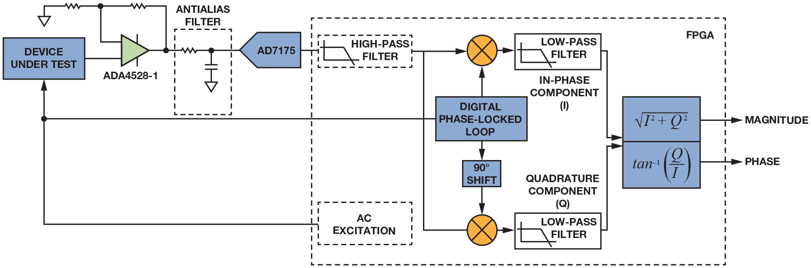
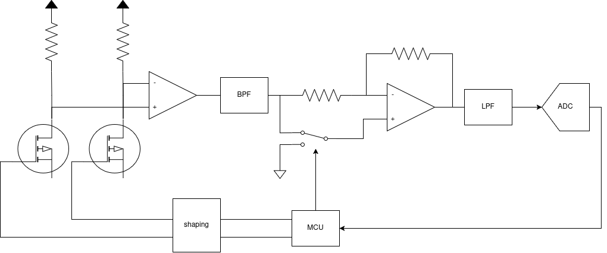

<!-- _class: lead -->
<!-- _paginate: false -->
<!-- _footer: '' -->

# LIA Board: Status and Decisions

**Eli Zeltser** · 29 October 2026

Presented to the GMOS research team

<!-- Facts: §0 of the prompt. Say: Status of the lock-in readout board that replaces the bench setup. What is decided, what is still open, and what I need from the team. -->

---

# What this talk covers

1. Board requirements as defined so far
2. Implementation topology discussion
3. Design guidelines
4. The major design decisions to be made
5. Risk management and mitigation strategy
6. Current status and the next goals

---

# Excitation, bias and filter band

- MUST Generate an sine wave excitation frequency that will drive the GMOS gate with variable phase, amplitude and frequency.
- HARD: must Ability to drive and sample six pixels; one active, one blind at a time.
- MUST Sensor bias 330 kΩ/, 5–10 µA; heater 2.5–4.0 V.
- TBD Amplifier gain and band.

<!-- Facts: S02-F08, S02-F09, S02-F10, S02-F11, S02-F12, S02-F13, S02-F14, S02-F15, S02-F17, S02-F18. Say: Excitation is the test signal. X and Y are the two demodulator references, in phase and quadrature. mVpp is millivolts peak to peak. A pixel is one sensor element. Gate nets GATE_A and GATE_B drive pixels 1–3 and 4–6; TMUX1109 switches connect one active and one blind pixel at a time. The sensor electrical model is not in the docs (S02-NF01). -->

---

# Signal chain, ADC and PC link

- MUST Chain: instrumentation amplifier, BPF, demodulator, post-filter (exact implementation may vary)
- MUST Signal must not get clipped in amplifier, while talking noise and offset into account.
- TBD Post-filter time constant 500 ms.
- TBD Analog-to-digital (ADC) choice: 24-bit sigma-delta ADS1220.

<!-- Facts: S02-F16, S02-F19, S02-F20, S02-F21, S02-F22, S02-F23, S02-F24, S02-F25. Say: The demodulator multiplies by plus or minus one, using references from the MCU. CMRR is common-mode rejection ratio, specified at gain 10. UART is a serial data link, here isolated from the PC side. ADC samples at 20 to 1000 samples per second (SPS). Not in docs: sensor electrical model (S02-NF01). -->
---

# Board power: Power source or lab supply

- MUST Lab supply and USB-C power; neither feeds the other.
- TBD +7 V rail, ripple ≤10 % (docs disagree, see open items).
- TBD Negative rails (only if front-end requires that).
- HARD: must Linear regulators for quite analog rails.
- HARD: must Converter switching never falls in the 377–711 Hz band.

<!-- Facts: S02-F01, S02-F02, S02-F03, S02-F04, S02-F05, S02-F06, S02-F07. Say: PD is power delivery over the USB-C cable. The lab supply is a second input through Schottky diodes, and neither input may feed the other. FE is the front-end circuit choice; D-18 is that decision. FLUID here means disputed or undecided in the docs; the tags are the author's reading. Supply values also disagree with the design-context document. -->

---

# Other considerations

- Hard Filter band fixes the possible excitation frequency.
- TBD BOM cost and component availability

---

# LIA Typologies

- Fully analog, all components fixed. Implement only the analog chain demodulator, sample using external sampling.
- Semi-analog. Signal chain contains ADC and a digital component to sample the signal, but demodulation itself is done in hardware
- Fully digital. Analog chain includes only amplifier, AA filter and an ADC. LIA implemented DSP.

---

# Board Error Costs and Implications

- Errors must be caught before fabrication
- The team wants everything at once, but mistakes are a cost that stays hidden
- Implementation of digital and analog readout components adds firmware, connectors, layout and more difficulties.
- Analog-only implementation keeps first tests simple
- Additional supportive circuitry such as DC, digital buffers, oscillators and passives.

---

# Band-pass filter Bandwidth

Do we set filter post sample to be fixed or adjustable? Wide or narrow?

| Option | Change needed | Risk | Mitigation |
|---|---|---|---|
| Fixed, high Q | Readjust R and C | Medium; require component rework for frequency outside band | In band: calibrate gain and phase |
| Switchable | Design and add preset filter sets | Medium. not designed yet | Design and simulate each preset |
| Wide, Q 0.707 | No re-tune | Medium; more mains, harmonics | Bench harmonic check |

---

# Band-pass filter: tuned or wide? (cont.)

| Unknown or conflict | Side one | Side two |
|---|---|---|
| Usable range | ≈400–700 Hz (requirements) | 305–700 Hz (firmware) |
| Range wanted | 100 Hz–10 kHz, draft (design-context) | ≈400–700 Hz (requirements) |
| Unknown | Re-tune procedure, part count, time | Switchable filter design |
| Unknown | Works for different excitation frequencies | Wide-band noise or harmonic results |

Open question to the team: how wide a band is needed, and is a wider filter acceptable?

---

# Drain-node MUX CMRR Risk

Minimize board size and BOM cost by multiplexing GMOS pairs via and analog switch

| Item | Risk | Status | Mitigation |
|---|---|---|---|
| Node capacitance | Medium | CMRR, addition of offset and drift | drop channel requirement or multiply analog chain|
| Keep both drain paths symmetric | Medium | Achieved symmetry | implement symmetry in layout, calibrate errors by operation point adjustment |
| Offset voltage | Medium | TBD | Measure leakage and compare with simulation results |

---

# Where the MCU Goes

| Option | What it means | Risk | Mitigation |
|---|---|---|---|
| A. MCU on board | One board, firmware from day one | MCU pins not wired yet | Review and netlist checks; EVB headers |
| B. MCU on EVB | Sine, references cross jumpers | VDDA, sine, references off-board | Not in docs |

EVB wiring also holds risks, need to consider MCU benefits

---

# My Recommendation: MCU Onboard

- One integrated board is easier to test
- Mitigation A: Conduct tight review and netlist checks to catch unwanted errors prior to fabrication
- Mitigation B: Connectors so we can fallback to analog only

---

# Analog Chain Implementation

---

# Analog Chain Implementation (cont.)

---

# Implementation Status

| done | in progress | open |
|---|---|---|
| Batch of simulations for switching LIA POC | under `simulations` | still consitering the requirements for the DC from those results |
| pixel pairing closed (21 oct) | front-end sheet (t04): 22/47 logged | cable 5 v supply (d-21) |
| DAC sheet | DAC and gate excitation adjustments done and verified | reference and supply |

---

# Nearby Goals

| Task | Dependencies | Note |
|---|---|---|
| Rails for AFE | Full system simulation and offset estimation | Mitigation may be to fabricate a board with only the AFE for testing |
| DC implementaion | After requirements are settled, choise of components and the simulations | None |
| MCU sheet and other digital components | availability | None |

