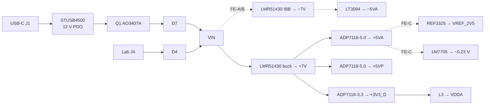
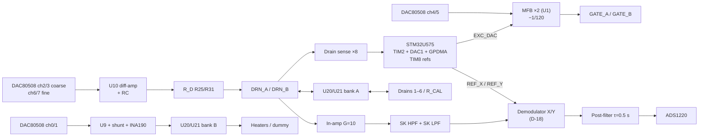

# LIA-Readout — Schematic Overview & Hardware Design

How the board implements [requirements.md](requirements.md). Theory is in [measurement_principles.md](../../documents/measurement_principles.md); the list of what is still wrong or missing in the KiCad schematic is in [schematic_review.md](schematic_review.md); simulations in [simulation-plan.md](../../../simulations/simulation-plan.md); firmware in [firmware_requirements.md](../../../firmware/firmware_requirements.md). Values marked `TBD` are not yet in the schematic.

Designators follow the **2026-10-24 17:20** netlist export unless stated otherwise.

## 1. Schematic Overview

### 1.1 Sheet Map

| Sheet path | Content | Status | Task |
|------------|---------|--------|------|
| `/` | Root, hierarchical blocks only | 🟡 | T05 |
| `/DC/USB_PD/` | STUSB4500 (U13), input P-FET Q1, TVS D8, back-feed diode D7 | 🟡 Q1 pull-up on wrong side | T03 |
| `/DC/Regulators/` | +7 V buck U15, −7 V IBB U18, LDOs U14/U16/U17, LT3094 U19, clamps D1/D2 | 🟡 values | T03 (depends on D-18) |
| `/Connectors/` | USB-C power J1, lab input J4 + D4, SWD J5, UART header J6, ESD D3 | 🟡 | T03, T08 |
| `/Analog/Excitation/` | Two MFB gate stages (U1) | 🟡 values, EXC_DAC not on PA4 | T01 |
| `/Analog/GMOS_soc/` | Socket J3, TMUX1109 ×2 (U20, U21), calibration loads R54–R56 | 🟡 cal values | T02 |
| `/Analog/LIA_FE/` | In-amp U2, band-pass U3, demodulator (U5/U6 AD630 as drawn), post-filters U4 | 🟡 **architecture pending D-18** | T04 |
| `/DAC/` | DAC80508 U8, heater drivers U9 + INA190 IC1/IC3, drain bias U10 + R_D R25/R31 | 🟡 IC2/IC4 on drain node | T06 |
| `/ADC/` | ADS1220 U7 | 🟡 SPI only | T07 |
| `/MCU/` | STM32U575 U12, isolator U11 (ISO6721) | 🟡 | T08 |

### 1.2 Net Naming

Target names. The rename pass ran on 2026-10-28 (net partition unchanged); "As drawn" gives the current name where it still differs, "same" where the schematic already uses the target name.

| Net | As drawn | Meaning |
|-----|----------|---------|
| `VBUS_PD` | same | USB-C power connector VBUS (Q1 source) |
| `V_USB_PD` | same | Q1 drain → D7 → `VIN` |
| `VIN` | same | Converter input (OR of USB-PD and lab input) |
| `VIN_LAB` | same | Lab input J4 → D4 anode (sheet pin on Connectors and DC) |
| `+7V`, `-7V` | same | Buck / IBB outputs (−7V only FE-A/B) |
| `+5VA`, `-5VA`, `+5VP`, `+3V3_D`, `VDDA` | same | Rails (−5VA only FE-A/B) |
| `VREF_2V5` | — | FE-C signal reference |
| `EXC_DAC` | same | MCU DAC1_OUT1 (PA4) → both gate stages |
| `CAL_DAC` | — | MCU DAC1_OUT2 (PA5), optional tone |
| `GATE_DC_A`, `GATE_DC_B` | same | DAC80508 ch4/ch5 → gate DC (R8 / R4) |
| `GATE_A`, `GATE_B` | same (bus `{GATE_A GATE_B}`) | Gate nets, pixels 1–3 / 4–6 |
| `HTR_A`, `HTR_B` | same | Heater force (shunt output, Kelvin point, U20/U21 DB) |
| `IHTR_A`, `IHTR_B` | same (bus `{IHTR_A IHTR_B}`) | INA190 outputs (IC3, IC1) → PC0, PC1 |
| `DRN_A`, `DRN_B` | same | Drain node per side: R_D bottom, U20/U21 DA, in-amp input, drain sense |
| `DSENSE_A`, `DSENSE_B` | — | Drain sense ×8 outputs → MCU ADC |
| `MUXA_A0/A1`, `MUXB_A0/A1`, `MUX_EN` | same (bus `{MUXA_A0 MUXA_A1 MUXB_A0 MUXB_A1}`) | Pixel select |
| `REF_X`, `REF_Y` | same | MCU timer references |
| `BPF_OUT` | same | Band-pass output → demodulator |
| `X_OUT`, `Y_OUT` | same | Post-filter outputs → ADS1220 |
| `VMID` / `VREF_2V5` | `VMID` (R52/R53, AD630 SEL A) | Mid reference (FE-A: AD630 threshold and post-filter; FE-C: V_REF) |
| `SPI_SCK/MISO/MOSI`, `DAC_CS`, `ADC_CS`, `ADC_DRDY` | same (`ADC_DRDY` not drawn yet) | SPI bus |
| `I2C_SCL`, `I2C_SDA`, `PD_ALERT` | same | I²C1 bus |

Use global labels only for rails; hierarchical labels with **identical names on both sides** for signals.

### 1.3 GMOS Socket (J3, DIP-40) Pin Map

| Pixel | Role | Mux position (A1A0) | Drain pin | Heater+ pin | Gate pin / net | Source / Heater− |
|-------|------|---------------------|-----------|-------------|----------------|------------------|
| 1 | Active | U20 00 | 17 | 11 | 12 / `GATE_A` | 13 / 16 → GND |
| 2 | Active | U20 01 | 10 | 4 | 5 / `GATE_A` | 6 / 9 → GND |
| 3 | Active | U20 10 | 3 | 39 | 40 / `GATE_A` | 1 / 2 → GND |
| 4 | Blind | U21 00 | 38 | 31 | 32 / `GATE_B` | 33 / 37 → GND |
| 5 | Blind | U21 01 | 30 | 23 | 24 / `GATE_B` | 25 / 29 → GND |
| 6 | Blind | U21 10 | 22 | 18 | 19 / `GATE_B` | 20 / 21 → GND |
| CAL | — | 11 | — (R_CAL) | — (dummy heater) | — | — |

Pins 8, 28 = GND; 15, 36 = VDD (+5VA, ESD protection, AN-33); 7, 14, 26, 27, 34, 35 = NC.

---

## 3. DC (Power) Section

### 3.1 Architecture

The STUSB4500 negotiates a 12 V PDO and only then enables Q1. A lab supply on J4 is OR-ed in through D4; D7 blocks back-feed from the lab input into the USB connector (Q1's body diode would otherwise conduct). `VIN` feeds:

- **Positive chain:** buck → +7 V → ADP7118 LDOs: +5VA (analog), +5VP (heaters), +3V3_D (digital). VDDA from +3V3_D via ferrite L3 (D-D).
- **Negative chain (FE-A/FE-B only):** the same buck IC in inverting buck-boost topology → −7 V → LT3094 → −5VA.
- **FE-C only:** REF3325 (2.5 V) from +5VA → `VREF_2V5`; LM7705 from +5VA → −0.23 V for the in-amp V− only. The negative chain is removed.



### 3.2 Component Selection

| Function | Part | Notes |
|----------|------|-------|
| PD sink | STUSB4500QTR (U13) | NVM PDOs: 5 V, 12 V, 15 V; "only above 5 V" so Q1 stays off on a 5 V-only source |
| Input switch | AO3407A (Q1, SOT-23, LCSC C15155) | P-channel; S = VBUS_PD, D = V_USB_PD; R42 100 kΩ **gate-to-source** (currently drain side, T03); R32 between gate and VBUS_EN_SNK (ST example 22 kΩ) |
| Back-feed diodes | B5819W (D4, D7) | 40 V, 1 A |
| Input TVS | SMAJ18A (D8) on VBUS_PD | V_RWM 18 V, V_C 29.2 V |
| +7 V buck / −7 V IBB | LMR51430XFDDCR (U15 / U18) | FPWM (DC-7) |
| +5VA, +5VP | ADP7118ACPZN5.0-R7 (U16, U14) | Fixed version; SENSE/ADJ tied to VOUT (already drawn), value must be changed (adjustable part would give 1.2 V) |
| +3V3_D | ADP7118ACPZN3.3-R7 (U17) | Same |
| −5VA (FE-A/B) | LT3094EMSE (U19) | R_SET 49.9 kΩ 0.1 % |
| Rail clamps | B5819W (D1, D2) | D2 only with −5VA |
| VREF_2V5 (FE-C) | REF3325AIDBZR (LCSC C69039) | ±5 mA, C_OUT 0.1–10 µF for stability, 70 µVpp 0.1–10 Hz |
| In-amp V− (FE-C) | LM7705MM (LCSC C129980) | −0.232 V, 26 mA, 4 mVpp ripple, 3–5.25 V input |

### 3.3 Design Calculations

| Item | Value |
|------|-------|
| U15 feedback (V_FB = 0.6 V) | R33 = 107 kΩ, R34 = 10.0 kΩ → 7.02 V (drawn 5.1 k/820 → 4.33 V) |
| U15 inductor L1 | 8.2 µH (6.2 µH acceptable), I_sat ≥ 1.5 A; e.g. Sunlord SWPA4020S8R2MT (C96889) |
| U15 capacitors | C_IN 2 × 4.7 µF 50 V + 100 nF; C_OUT 2 × 22 µF 25 V; C_BOOT 100 nF; C_FF 10 pF |
| U18 (FE-A/B) | IC GND pin on −7 V (drawn ✓); R35 (GND→FB) 107 kΩ, R36 (FB→−7V) 10.0 kΩ; L2 8.2 µH; 2 × 4.7 µF 50 V between VIN and −7 V; C_OUT 2 × 22 µF |
| ADP7118 (all) | EN → VIN; SS open (380 µs); C_OUT ≥ 2.2 µF X7R; C_IN 1 µF + 100 nF |
| LT3094 (FE-A/B) | R_SET 49.9 kΩ, C_SET 4.7 µF, C_OUT 10 µF; ILIM/VIOC/PG per datasheet |
| LDO dissipation | +5VA 0.09 W, +5VP 0.04 W, +3V3_D 0.31 W |

### 3.4 USB-C PD Input (U13)

As drawn and correct: VDD (24) on VBUS_PD; VBUS_VS_DISCH (18) via R44 + R45 (2 kΩ) to VBUS_PD; DISCH (9) via R46 to V_USB_PD; CC1/CC1DB and CC2/CC2DB tied to J1 CC lines; VREG_1V2/VREG_2V7 1 µF; RESET via R47 to GND; ADDR0/1 to GND; I²C to PB6/PB7 with 4.7 kΩ pull-ups; ALERT/ATTACH 4.7 kΩ pull-ups.

---

## 4. Analog Section

### 4.1 Functions

1. Gate bias: two gate nets, each an MFB stage adding its own DAC80508 DC level to the same MCU sine.
2. Pixel selection: one active (1–3) and one blind (4–6) pixel at a time; others disconnected (drain and heater open).
3. Drain bias: coarse/fine difference amplifier per side → R_D (one per side) → switch → drain; drain-voltage (current) measurement at the R_D node.
4. Heater bias: one DAC channel + driver + current sense per side, switched to the selected pixel.
5. Differential amplification and band-pass filtering (in-amp at the two R_D nodes).
6. Synchronous demodulation into X and Y (architecture D-18).
7. Post-filtering and digitization of X, Y; digitization of bias currents.

### 4.2 Signal Chain Overview



### 4.3 Requirements

See [requirements.md R.2](requirements.md#r2-analog). Not repeated here.

### 4.4 Common Components

| Function | Part | Qty | Notes |
|----------|------|-----|-------|
| Bias DAC | DAC80508ZRTER (U8) | 1 | Internal 2.5 V ref; REF pin decoupled per datasheet |
| R_D | 330 kΩ 0.1 % ±25 ppm/°C thin film, matched pair (R25, R31) | 2 | LCSC: Uniroyal TC0325B3303T5F (C2989388), Yageo RT0603BRD07330KL (C861327) |
| Heater sense | INA190A1 (IC1, IC3) + 15 Ω 0.1 % shunt (R24, R30) | 2 | VS = VDDA |
| Selection | TMUX1109PWR (U20, U21) | 2 | On-cap ≈ 38 pF (drain node) |
| General op-amp | OPA2196 (U1, U9, U10, drain sense; U3/U4 in FE-A/B) | | Input transition region (V+)−3 V…(V+)−1.5 V: keep signal inputs out of it |

### 4.5 Excitation (sheet `/Analog/Excitation/`)

Two identical MFB low-pass summing stages, both fed by the same `EXC_DAC` sine ([§2.12](../../documents/measurement_principles.md#212-excitation-and-reference-generation), firmware in [firmware_requirements.md](../../../firmware/firmware_requirements.md)):

$$
V_{G} = \left(1 + \frac{R_{fb}}{R_{in}}\right)V_{DC} - \frac{R_{fb}}{R_{in}}\,V_{EXC}, \qquad f_0 = \frac{1}{2\pi\sqrt{R_{fb}R_3C_{X}C_{fb}}}, \qquad Q = \frac{\sqrt{R_{fb}R_3C_{X}C_{fb}}}{C_{fb}\left(R_{fb} + R_3 + R_{fb}R_3/R_{in}\right)}
$$

```latex
V_{G} = \left(1 + \frac{R_{fb}}{R_{in}}\right)V_{DC} - \frac{R_{fb}}{R_{in}}\,V_{EXC}, \qquad f_0 = \frac{1}{2\pi\sqrt{R_{fb}R_3C_{X}C_{fb}}}, \qquad Q = \frac{\sqrt{R_{fb}R_3C_{X}C_{fb}}}{C_{fb}\left(R_{fb} + R_3 + R_{fb}R_3/R_{in}\right)}
```

| Element | Stage B (U1A → `GATE_B`) | Stage A (U1B → `GATE_A`) | Value |
|---------|--------------------------|--------------------------|-------|
| R_in (EXC_DAC → X node) | R2 | R6 | 120 kΩ 0.1 % |
| R_fb (output → X node) | R1 | R5 | 1.00 kΩ 0.1 % |
| R_3 (X node → −IN) | R3 | R7 | 1.00 kΩ 0.1 % |
| C_X (X node → GND) | C3 | C7 | 47 nF C0G 1 % |
| C_fb (output → −IN) | C1 | C6 | 22 nF C0G 1 % |
| DC input filter (+IN) | R4 / C5 (← DAC ch5) | R8 / C8 (← DAC ch4) | 10 kΩ / 1 µF |
| Output series (new, outside loop) | 100 Ω | 100 Ω | recommended |

AC gain −1/120, f₀ = 4.95 kHz, Q = 0.73, phase lag at 518 Hz ≈ 8° (calibrated). DC: V_G = 1.0083·V_DC − 13.8 mV, so V_DC = 0.976–1.204 V gives 0.97–1.2 V. U1 inputs stay below 1.3 V, outside the OPA2196 transition region on either supply option.

### 4.6 Bias DACs, Heaters and Drains

#### 4.6.1 DAC80508 Channel Allocation (as drawn)

| Ch | Net (as drawn) | Function | Range | Load |
|----|----------------|----------|-------|------|
| 0 | `DAC0` | Heater A (active) setpoint | gain 1, driver ×2 | U9B +IN |
| 1 | `DAC1` | Heater B (blind) setpoint | gain 1, driver ×2 | U9A +IN |
| 2 | `DAC2` | Drain supply A, coarse | gain 2 | U10A +IN |
| 3 | `DAC3` | Drain supply B, coarse | gain 2 | U10B +IN |
| 4 | `GATE_DC_A` | Gate DC A (pixels 1–3) | gain 1 | R8 |
| 5 | `GATE_DC_B` | Gate DC B (pixels 4–6) | gain 1 | R4 |
| 6 | `DAC6` | Drain supply A, fine | gain 1 | R23 |
| 7 | `DAC7` | Drain supply B, fine | gain 1 | R29 |

All channels are used, so the X/Y mid reference (`VMID`) comes from a divider (FE-A/B) or the REF3325 (FE-C), not from the DAC.

#### 4.6.2 Heater Drivers (U9)

U9B (A, DAC0) and U9A (B, DAC1): non-inverting gain 2 (R26/R28, R20/R22 = 50 kΩ), output through the 15 Ω shunt (R30 / R24) to `HTR_A` / `HTR_B` (U20/U21 DB); feedback R26/R20 from the heater side of the shunt ✓ (Kelvin, AN-13). INA190A1 IC3/IC1 across the shunts, VS = VDDA, outputs → PC0/PC1 (add 1 kΩ / 100 nF RC). U9 on +5VP (and −5VA or GND).

#### 4.6.3 Drain Supply (U10) and R_D

U10A/U10B: difference amplifier V_SUP = (1+k)·V_coarse − k·V_fine ([§2.14](../../documents/measurement_principles.md#214-drain-bias-with-coarse-and-fine-dacs)).

| Ref | Value (target) | Drawn |
|-----|----------------|-------|
| R21 / R27 (R_F, output → −IN) | 10.0 kΩ 0.1 % | 50 kΩ |
| R23 / R29 (R_G, −IN → fine DAC) | 100 kΩ 0.1 % | 50 kΩ |
| Output filter (new) | 1 kΩ series + 10 µF X7R to GND, between U10 output and R_D | — |
| R25 / R31 (R_D) | 330 kΩ 0.1 % matched pair | 330k ✓ |
| IC2 / IC4 (INA190 across R_D) | **delete** (they saturate at 10 µA and load the drain node) | present |

The node below R_D (`DRN_A`/`DRN_B`) is the drain node: it connects to U20/U21 DA, the in-amp input and the drain-sense buffer only. Place R25/R31, U20/U21 and the in-amp close together and guard the nodes.

#### 4.6.4 Drain DC Sense (new dual op-amp, OPA2196)

`DRN_A`/`DRN_B` → non-inverting ×8 (R_F 7.15 kΩ, R_G 1.02 kΩ) → 10 kΩ + 1 µF → `DSENSE_A`/`DSENSE_B` → PC2/PC3 (replacing the former `GMOS_Imeas2/3`). Full scale 412 mV at the drain. Inputs at 0–0.5 V, outside the transition region.

### 4.7 Pixel Selection and Calibration Loads

U20 (active) and U21 (blind), TMUX1109 on +5VA, VSS = GND. Address per side (`MUXA_A0/A1` → U20, `MUXB_A0/A1` → U21), common `MUX_EN` with R38 100 kΩ pull-down.

| A1 A0 | U20 bank A / bank B | U21 bank A / bank B |
|-------|---------------------|---------------------|
| 00 | DRAIN_1 / HEATER_1 | DRAIN_4 / HEATER_4 |
| 01 | DRAIN_2 / HEATER_2 | DRAIN_5 / HEATER_5 |
| 10 | DRAIN_3 / HEATER_3 | DRAIN_6 / HEATER_6 |
| 11 | R_CAL (R54) / dummy heater (new) | R_CAL (R55) / dummy heater (R56) |
| EN = 0 | all off | all off |

| Ref | Target | Drawn |
|-----|--------|-------|
| R54, R55 (R_CAL to GND) | 18.0 kΩ 0.1 % | 100 kΩ |
| R56 + new on U20 S4B (dummy heater to GND) | 680 Ω–1 kΩ 0.1 %, ≥ 0.125 W | 100 kΩ, only on U21 |
| Optional tone injection | Active-side R_CAL to GND through 100 Ω; 10 kΩ from `CAL_DAC` (PA5) to that 100 Ω node; blind side 100 Ω to GND | — |

Firmware switching sequence: heater DACs → 0; EN = 0; set addresses; EN = 1; ramp heaters; wait for thermal and filter settling (FW-12).

### 4.8 In-Amp Input

The in-amp connects to `DRN_A`/`DRN_B` directly (IC5/IC6 removed, D-19). As drawn, +IN = blind (`DRN_B`), −IN = active (`DRN_A`): sign handled in firmware. R_G (R10) = 5.62 kΩ 0.1 % for INA828 (G = 9.90) or 11.0 kΩ for INA333 (G = 10.09).

### 4.9 Front-End Architecture Options (Decision D-18)

All options have the same overall scale factor (−38.2·v̂·cos θ at the ADC), τ = 0.5 s, linear range ≈ 53 mV pk drain. Selection procedure: [simulation-plan.md §7.4](../../../simulations/simulation-plan.md#74-decision-matrix-for-d-18-fill-in-from-73-and-research).

| Block | FE-A (as drawn) | FE-B | FE-C |
|-------|-----------------|------|------|
| Supplies | ±5 V | ±5 V | +5 V, V_REF 2.5 V, −0.23 V (in-amp only) |
| In-amp | INA828, REF = GND | INA828, REF = GND | INA333 (V− = LM7705), REF = V_REF |
| Band-pass | Unity-gain SK, 4:1 ratios, ×1 | Equal-component SK, K = 2, ×4 | Equal-component SK, K = 2, ×4, returns to V_REF |
| Band-pass op-amp | OPA2196 (U3) | OPA2196 (U3) | **OPA2365** (zero-crossover) |
| Demodulator | 2× AD630, gain ±2 (Fig. 29 wiring, as drawn); SEL B = REF_X/REF_Y, SEL A = mid divider | 1× TMUX6136 (dual SPDT, ±5 V) + OPA2196, gain ±1; zero input = GND | 2× TMUX1219 + OPA2365, gain ±1; zero input = V_REF |
| Post-filter | −3: R_IN 100 kΩ, R_F 301 kΩ, C_F 1.66 µF film, +IN = VMID/4 | −1.5: R_IN 200 kΩ, R_F 301 kΩ, C_F 1.66 µF film, +IN = VMID/2.5 | −1.5: same values, +IN = V_REF |
| ADC reference input (AIN1/AIN3) | VMID (divider) | VMID (divider) | V_REF |
| Removed vs FE-A | — | 2× AD630, comparator divider, X/Y sync pull-ups | Same + −7 V IBB, LT3094, D2, their passives |
| Availability (JLC, 2026-10) | AD630: not stocked at JLC; LCSC lists ≈ USD 54, out of stock | TMUX6136: 158 pcs (≈ USD 6.4) | TMUX1219 8 k, INA333 3 k, OPA2365 4 k, LM7705 1.5 k, REF3325 18 k |
| Main risk | Part availability/cost; ±0.8 V demodulator input limit | Single low-stock switch | New front end; transition-region and start-up behaviour must be simulated (SIM-11, SIM-18) |

**FE-B / FE-C band-pass values (both sections):** C = 33 nF C0G 1 %, R = 9.31 kΩ 0.1 %, gain resistors 10.0 kΩ / 10.0 kΩ 0.1 % (K = 2, Q = 1, ×2 per section).

**Switch demodulator wiring (FE-B/FE-C, per channel):** BPF_OUT → R_i 10.0 kΩ → op-amp −IN; R_f 10.0 kΩ from −IN to output; op-amp +IN ← switch common (D); switch S1 (selected when SEL = 0) = zero (GND or V_REF), S2 = BPF_OUT; SEL ← REF_X (X channel) / REF_Y (Y channel). TMUX1219 SOT-23-6 pinout: 1 SEL, 2 VDD, 3 GND, 4 S1, 5 D, 6 S2.

### 4.10 X/Y ADC (U7)

ADS1220 on +5VA (AVDD) / +3V3_D (DVDD), internal 2.048 V reference. AIN0 = X_OUT, AIN1 = mid reference, AIN2 = Y_OUT, AIN3 = mid reference; measurement AIN0−AIN1 and AIN2−AIN3. 100 Ω + 10 nF C0G RC at AIN0/AIN2. CLK → DGND (internal oscillator). SPI to MCU (drawn), CS and DRDY → MCU GPIO (T07).

### 4.11 Layout & Grounding

- One ground plane; analog and digital areas separated, joined near the power entry; no digital traces over the analog front end.
- Switchers (buck, IBB) at the far end from the socket and front end.
- Drain nodes (socket → U20/U21 → R25/R31 → in-amp) strictly symmetric, short, guarded; nothing else on them except the drain-sense buffer input.
- REF_X/REF_Y (fast edges) away from the drain nodes and the in-amp, routed only to the demodulator.
- FE-C: `VREF_2V5` star-routed from the REF3325 to every reference point, decoupled locally.
- R_D, band-pass parts and references away from heat sources.
- Isolated UART: keep the isolation gap under U11 free of copper on all layers.

---

## 5. Digital Section

### 5.1 MCU (STM32U575RGT6, U12)

Cortex-M33, 160 MHz, LQFP64, LDO version. LQFP64 has no VREFBUF; VREF+ = VDDA.

Mandatory pin handling (T08): VDD (19, 32, 64) +3V3_D with 100 nF each + 4.7 µF; VDDA (13) 1 µF + 100 nF; VCAP (30) 4.7 µF; VBAT (1) → +3V3_D; VDDUSB (48) → +3V3_D; NRST (7) 100 nF (C49) + J5; PH3-BOOT0 (60) 10 kΩ to GND.

### 5.2 Clock

16 MHz CMOS XO (e.g. YXC OT322516MJBA4SL, LCSC C725988) → 33 Ω → PH0 (pin 5), HSE bypass; PLL → 160 MHz.

### 5.3 Pin Allocation

| Function | Pin(s) | Status | Notes |
|----------|--------|--------|-------|
| EXC_DAC | PA4 (pin 20) DAC1_OUT1 | **to connect** | |
| CAL_DAC (optional) | PA5 (pin 21) DAC1_OUT2 | free | |
| REF_X / REF_Y | PC6 / PC7 (pins 37/38), TIM8_CH1/CH2 | **to connect** | AF3, verified (D-20) |
| SPI (DAC80508, ADS1220) | PA1 / PA6 / PA7 (pins 15/22/23) | drawn | SPI1, AF5, verified (D-20) |
| DAC_CS, ADC_CS, ADC_DRDY | 3 GPIO | to connect | |
| USART2 → ISO6721 | PA2 TX (16), PA3 RX (17) | drawn, **TX/RX swapped at U11** | PA2 → U11 pin 7 (INA), PA3 ← U11 pin 6 (OUTB) |
| I²C1 | PB6 SCL (58), PB7 SDA (59) | drawn | STUSB4500, TMP117, SHT40 |
| ADC inputs | PC0 IHTR_A, PC1 IHTR_B | drawn | PC2/PC3 no longer used for drain sense (2026-10-28); free |
| Pixel select | 5 GPIO (MUXA_A0/A1, MUXB_A0/A1, MUX_EN) | to connect | |
| PD_ALERT (STUSB4500) | 1 GPIO | to connect | Target name in §1.2; STUSB4500 ALERT is not yet wired to the MCU |
| SWD | PA13 (46), PA14 (49) via 33 Ω | drawn ✓ | |
| HSE | PH0 (5) | to connect | |

### 5.4 Peripherals

| Function | Part | Notes |
|----------|------|-------|
| Temperature | TMP117 | I²C |
| Humidity + temperature | SHT40 | I²C |
| UART isolator | ISO6721BD (U11) | Side 1 (pins 1–4) = cable side, side 2 (pins 5–8) = MCU side |
| PC cable | FTDI TTL-232R (external) | 6-pin header in FTDI order; isolated side powered from the cable VCC (5 V on TTL-232R-3V3: confirm its RXD tolerates 5 V, or add a 3.3 V LDO on the isolated side, or use TTL-232R-5V) |
| Debug | J5 (VDD, SWDIO, SWCLK, NRST, GND) | |

### 5.5 Firmware

See [firmware_requirements.md](../../../firmware/firmware_requirements.md) (CubeMX configuration, excitation/reference module, drivers).

### 5.6 PC Link

ASCII command/response lines (e.g. `SET GATE A 0.9900`, `SET EXC 518.0 5.0`, `SET PHASE 3`, `SET CH 1 4`, `CAL ZERO`, `STREAM ON 100`) and fixed-length binary frames for streaming:

| Field | Bytes |
|-------|-------|
| Sync header | 1 |
| Sequence number | 2 |
| Timestamp (µs) | 4 |
| X (24-bit) | 3 |
| Y (24-bit) | 3 |
| Drain voltages, 2 × 16-bit | 4 |
| Heater currents of the selected pair, 2 × 16-bit | 4 |
| Channel + status flags | 1 |
| CRC-16 | 2 |
| **Total** | **24** |

At 921 600 baud: 20 frames/s = 0.5 %, 1000 frames/s = 26 % of the link.

---

## 6. Power Budget

1.5× margin; 2 heaters at 600 Ω / 4 V.

| Rail | FE-A | FE-B | FE-C |
|------|------|------|------|
| +5VP | 21 mA | 21 mA | 21 mA |
| +5VA | 44 mA (incl. 2× AD630 ≈ 10 mA) | 37 mA | ≈ 60 mA (OPA2365 ≈ 5 mA/dual ×2, LM7705, REF3325) |
| −5VA | 20 mA | 13 mA | — |
| +3V3_D | 69 mA | 69 mA | 69 mA |
| Input @ 12 V | ≈ 0.11 A | ≈ 0.11 A | ≈ 0.10 A |